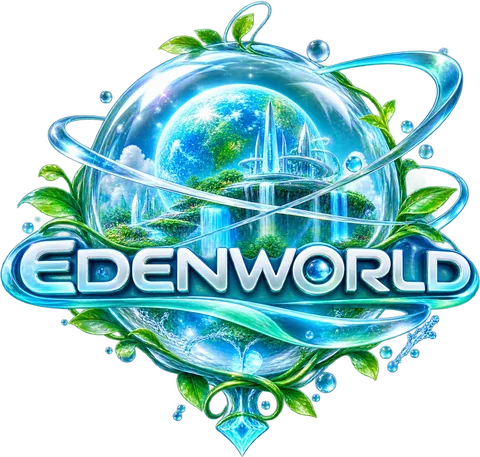

<p align="center">
  
</p>

# EDENWORLD — Genesis 0.2 · “A cidade ganha gente”

**A World Beyond Imagination.** Um mundo aberto em 3D do universo Éden Aero que roda direto no navegador — no computador, no celular e no tablet, sem instalar nada.

**Aurora City** é uma cidade-jardim à beira-mar para explorar a pé com um avatar criado por você — agora habitada: moradores com rotina própria, as onze figuras do panteão do Éden em seus lugares, um EdenOS com aplicativos que funcionam de verdade e a tecnologia **Afters** liberada por Luma.

## O que há nesta versão

- **Aurora City**, com 11 áreas: Praça Central (e a Esfera Aurora), Centro de Aurora, Distrito Cristal, Vila das Nuvens, Parque das Águas, Ilha do Gazebo, Jardins Suspensos, Mirante Celeste, Palco Aurora, Orla Cristalina e Píer da Orla.
- **Criador de avatar**: nome, tom de pele, cabelo, olhos, roupa, cores, acessório e altura. O visual pode ser trocado depois no Ateliê Aero ou pelo EdenPhone.
- **Exploração em terceira pessoa**: andar, correr, pular, nadar, sentar e acenar, com câmera que desvia de obstáculos.
- **128 pontos de interação**: a Esfera Aurora, fontes, bancos, placas, holomapa, painel de eventos, telescópios, portais e o ateliê.
- **Coisas para encontrar**: 24 Cristais de Luz, 31 anotações no diário e 8 portais que, depois de ativados, permitem viagem rápida.
- **Habitantes de Aurora City**: 54 moradores simulados ao mesmo tempo (até 18 visíveis, conforme a qualidade), cada um com nome, ocupação, roupa, velocidade e rotina que muda de madrugada, manhã, tarde e noite. Dá para conversar com qualquer um.
- **O panteão em pessoa**: Aérion, Haru, Nexara, Suki‑Chan, Luma, Lilly, Akemi‑Chan, Saturno, Maze, Júpiter e Amara estão em pontos fixos da cidade, com aura, plaquinha de nome, diálogo em árvore, registro no diário e contato no EdenPhone.
- **EdenOS no EdenPhone**, com 14 aplicativos: mapa com viagem rápida, diário, jornada, câmera (foto em PNG), céu, **Pessoas**, **EdenTalk**, **EdenGram**, **EdenFeed**, **EdenReads**, **Afters**, **EdenMusic**, eventos e ajustes.
- **Afters 2.0 (Body Expansion Tech)**: seis produtos do cânone — AfterBust®, AfterCurve®, GelGrow®, CandyGrow®, AfterLove e AfterVelvet — liberados por Luma no Ateliê Aero.
  - **AfterBust®** e **AfterCurve®** são os dois produtos que **transformam o avatar**: silhueta superior e silhueta inferior, de **0% a 250%**, cada um com interruptor, slider, leitura numérica e botão **Reiniciar** próprios. Podem ser usados separados ou **combinados**, ligados e desligados de forma independente, e ajustados **enquanto você anda, corre ou conversa** — sem recarregar a cena, sem teleporte e sem trocar de avatar. A duração da transição é um controle à parte da intensidade. Em 0% a silhueta original volta exatamente como era.
  - Os outros quatro produtos (GelGrow®, CandyGrow®, AfterLove, AfterVelvet) são **efeitos complementares** — anel de presença, halo e partículas em volta do corpo. Ficam numa seção à parte, com cor, intensidade, som e desligamento manual: nunca substituem a transformação. A luz de assinatura do AfterBust® e do AfterCurve® fica dentro da seção de cada um.
  - Desligar guarda a porcentagem escolhida; **Reiniciar** volta ao padrão de 0%. Intensidades, ativações, duração e preset são gravados no salvamento.
  - **A cidade também usa.** Os moradores de Aurora City e as figuras do panteão passam pela mesma tecnologia, pelo mesmo sistema: cada um com a própria configuração de 0% a 250%, nos dois canais, separados ou combinados, estável enquanto a pessoa anda, corre ou está parada. Quem usa e quanto depende do perfil — a artista arrisca mais, o cuidador quase não usa —, e a escolha é sorteada da semente do habitante, então a cidade é a mesma em toda sessão. À noite quem tem esse gosto reforça um pouco; no **Palco Aurora** a cidade inteira sobe o tom. Um roteiro pode ligar, desligar ou trocar o preset de uma pessoa específica, e essa mudança é gravada no salvamento.
- **Dia e noite** (um dia dura 24 minutos reais) e clima variável: céu limpo, brisa e neblina.
- **Três formas de jogar**, com troca automática entre elas: teclado e mouse, tela de toque e controle. Teclas e botões podem ser remapeados.
- **Configurações** de gráficos (três níveis de qualidade, sombras, reflexos, escala de resolução, resolução dinâmica), áudio, controles e jogo.
- **Salvamento automático** no próprio navegador, com opções de continuar, novo jogo, exportar, importar e apagar.
- **Interface em português do Brasil**, navegável por mouse, toque, teclado e controle.

Os recursos que ainda dependem de servidor, loja ou catálogo licenciado (Éden Connect, EdenStore, EdenTV, EdenGame, EdenPawl e os eventos com data) continuam aparecendo apenas como **“em breve”**: nenhum deles simula algo que não existe. Os aplicativos sociais que **existem** dizem, dentro da própria tela, que tudo fica guardado só naquele aparelho — não há conta, servidor nem outras pessoas on‑line.

## Como jogar

### Teclado e mouse

| Ação | Comando |
| --- | --- |
| Andar | `W` `A` `S` `D` ou setas |
| Correr | `Shift` |
| Pular | `Espaço` |
| Interagir | `E` ou `Enter` |
| EdenPhone | `Tab` ou `P` |
| Acenar | `G` |
| Centralizar a câmera | `C` |
| Pausar / menu | `Esc` |
| Girar a câmera | mover o mouse (clique no jogo para capturar o cursor) ou arrastar |
| Zoom | roda do mouse |

### Tela de toque

| Ação | Comando |
| --- | --- |
| Andar | analógico virtual no lado esquerdo da tela |
| Girar a câmera | arrastar o dedo no restante da tela |
| Zoom | movimento de pinça |
| Pular, correr e interagir | botões no canto inferior direito |
| EdenPhone e menu | botões no canto superior direito |

### Controle (padrão Xbox / PlayStation)

| Ação | Comando |
| --- | --- |
| Andar | analógico esquerdo |
| Girar a câmera | analógico direito |
| Pular | `A` / Cruz |
| Correr | `RT` / `R2` |
| Interagir | `X` / Quadrado |
| EdenPhone | `Y` / Triângulo |
| Acenar | direcional para cima |
| Centralizar a câmera | `R3` |
| Zoom | `LB` e `RB` |
| Pausar / menu | `Start` / `Options` |

Nos menus: direcional ou analógico esquerdo para navegar, `A` confirma, `B` volta, `LB`/`RB` trocam de aba.

As teclas e os botões de ação podem ser trocados em **Configurações**.

## Requisitos

- Para jogar: um navegador atual com **WebGL2** (Chrome, Edge, Firefox ou Safari recentes). Sem WebGL2, o jogo mostra uma tela de aviso em vez de abrir.
- Para desenvolver: **Node.js 22.12** ou mais novo (de preferência uma versão LTS) e npm.

## Rodando o projeto

```bash
npm install      # instala as dependências
npm run dev      # servidor de desenvolvimento em http://localhost:5173
```

Outros comandos:

| Comando | O que faz |
| --- | --- |
| `npm run build` | Confere os tipos e gera a versão de produção na pasta `dist/` |
| `npm run preview` | Serve a pasta `dist/` em http://localhost:4173 para conferência |
| `npm run typecheck` | Só a checagem de tipos do TypeScript |
| `npm test` | Testes unitários (Vitest) |
| `npm run test:e2e` | Gera o build e roda os testes de ponta a ponta em um Chromium sem interface |

Para abrir o servidor de desenvolvimento por um túnel ou outro domínio, informe os hosts permitidos:

```bash
EDENWORLD_ALLOWED_HOSTS=".meu-tunel.dev" npm run dev
```

## Publicação

O jogo é um **site estático**: `npm run build` gera a pasta `dist/` (cerca de 1,7 MB; aproximadamente 260 kB de código compactado com gzip) e basta hospedar o conteúdo dela. Não há servidor, banco de dados nem variáveis de ambiente.

- Os caminhos são relativos (`base: './'` no `vite.config.ts`), então o jogo funciona tanto na raiz de um domínio quanto em uma subpasta, como `https://usuario.github.io/EdenWorld/`.
- Sirva por **HTTPS**: alguns navegadores só liberam o uso do controle em páginas seguras.
- Qualquer hospedagem de arquivos estáticos serve: GitHub Pages, Netlify, Vercel, Cloudflare Pages, itch.io (envie o conteúdo de `dist/` em um arquivo `.zip`) ou um servidor próprio.

### Exemplo: GitHub Pages

No plano gratuito do GitHub, o Pages só está disponível para repositórios públicos. Para publicar automaticamente a cada atualização do ramo `main`, ative **Settings → Pages → Source: GitHub Actions** e crie o arquivo `.github/workflows/publicar.yml`:

```yaml
name: Publicar no GitHub Pages

on:
  push:
    branches: [main]
  workflow_dispatch:

permissions:
  contents: read
  pages: write
  id-token: write

concurrency:
  group: pages
  cancel-in-progress: true

jobs:
  build:
    runs-on: ubuntu-latest
    steps:
      - uses: actions/checkout@v7
      - uses: actions/setup-node@v7
        with:
          node-version: 22
          cache: npm
      - run: npm ci
      - run: npm test
      - run: npm run build
      - uses: actions/upload-pages-artifact@v5
        with:
          path: dist

  deploy:
    needs: build
    runs-on: ubuntu-latest
    environment:
      name: github-pages
      url: ${{ steps.deployment.outputs.page_url }}
    steps:
      - id: deployment
        uses: actions/deploy-pages@v5
```

Este arquivo não faz parte do repositório: a escolha da hospedagem fica com quem publica.

## Testes

```bash
npm run typecheck   # tipos
npm test            # 202 testes unitários (lógica pura, sistemas e telas do EdenOS)
npm run test:e2e    # cinco cenários de ponta a ponta sobre o build de produção
```

Os **testes unitários** (`tests/unit/`) cobrem matemática, colisão, movimento do personagem, relógio do mundo, aparência do avatar, configuração de controles, níveis de qualidade, interações e salvamento (incluindo a migração da versão 1 para a 2). Desde a Genesis 0.2 também cobrem a rede de caminhada e a rotina dos habitantes, a coerência do panteão e das árvores de diálogo, o acervo do EdenReads, o estado social do aparelho, o catálogo Afters e a transformação de silhueta do Afters 2.0 (0%, mínimo, máximo, valores intermediários, canais separados, modo combinado, desligamento independente, mudança ao vivo, persistência e compatibilidade com salvamentos antigos) — e, para a cidade, que habitante e jogador usam o mesmo ator de silhueta, que avatares reaproveitados não herdam a silhueta de quem saiu, que transformar ninguém reconstrói malha, que gente longe é atualizada em frequência reduzida sem perder o destino, e que o mesmo habitante fica igual para dois jogadores — e, em um DOM de teste (`happy-dom`), **as telas dos aplicativos**: cada botão precisa chamar o jogo de verdade, nenhum é enfeite.

Os **testes de ponta a ponta** (`tests/e2e/`) abrem o jogo em um Chromium sem interface e o usam como um jogador:

| Cenário | O que percorre |
| --- | --- |
| `desktop` | Menu, criador, movimento, interações, EdenPhone, modo foto e configurações com teclado e mouse |
| `persistencia` | Salvar, recarregar, continuar, novo jogo, exportar, apagar e importar |
| `celular` | Tela de toque em retrato (390×844) e paisagem (844×390) |
| `controle` | Jogo e menus só com o controle, incluindo conectar e desconectar |
| `robustez` | Navegador sem WebGL2, armazenamento bloqueado, salvamento corrompido ou adulterado, perda do contexto gráfico e limite do mapa |

> **Atenção:** os cenários de ponta a ponta da Genesis 0.2 **não foram executados** nesta máquina — não há Chrome/Chromium instalado e o download está bloqueado. Rode-os localmente antes de publicar.

```bash
node tests/e2e/run.mjs celular controle                   # só alguns cenários (exige "npm run build" antes)
EDEN_URL=http://localhost:5173/ node tests/e2e/run.mjs    # testa um servidor que já está no ar
```

O executor procura um Chrome, Chromium ou Edge instalado. Se não encontrar, informe o caminho em `EDEN_CHROME`. As capturas de tela vão para `tests/e2e/artifacts/` (fora do Git; mude com `EDEN_ARTIFACTS`). Em máquinas sem placa de vídeo a renderização é feita por software e a suíte completa leva de 10 a 15 minutos.

## Estrutura

```text
index.html               página única do jogo
public/                  logotipo, ícones e manifesto do aplicativo web
design/brand/            logotipo original e a origem dos arquivos derivados
src/
  main.ts                ponto de entrada: checa o WebGL2 e inicia o Engine
  core/                  Engine (orquestra tudo), laço do jogo, renderizador, configuração
  world/                 terreno, céu, água, luz, clima, relógio, vegetação, partículas
  cities/aurora-city/    planta, prédios, praça, parques e decoração de Aurora City
  npc/                   rede de caminhada, rotina dos habitantes e desenho dos moradores
  characters/            panteão do Éden (dados, lugares e árvores de diálogo)
  edenos/                acervo do EdenReads e estado social do aparelho
  afters/                catálogo, transformação de silhueta e efeitos em volta do avatar
  physics/               colisão e consultas ao cenário (sem biblioteca externa)
  player/                avatar, animação, aparência e movimento
  camera/                câmera em terceira pessoa
  input/                 teclado e mouse, toque, controle e remapeamento
  interactions/          pontos de interação e colecionáveis
  systems/               qualidade gráfica, salvamento, progresso e áudio
  interface/             HUD, menus, criador de avatar, EdenPhone e configurações
  styles/                folha de estilo da interface
  utils/                 matemática e geometria de apoio
  shared/                catálogo dos recursos “em breve”
  eden-connect/, social/ pontos de extensão para os futuros recursos on-line
tests/
  unit/                  testes unitários (Vitest)
  e2e/                   testes de ponta a ponta (puppeteer-core)
```

Feito com **TypeScript**, **Three.js** (WebGL2) e **Vite**. Não há motor de jogo, biblioteca de física nem framework de interface.

### Conteúdo gerado por código

Modelos, texturas, céu, água, vegetação, sons e música são gerados em tempo de execução. O único arquivo de imagem do jogo é o logotipo (`public/assets/ui/`) e os ícones derivados dele. Por isso o download é pequeno e não há dependência de arquivos de terceiros.

### Dados e privacidade

- O progresso e as preferências ficam apenas no `localStorage` do navegador, na chave `edenworld.save.v1` (formato na versão 2; salvamentos da versão 1 continuam sendo aceitos).
- As fotos do EdenGram, os contatos, as conversas lidas e os ajustes de Afters são gravados nesse mesmo salvamento, no próprio aparelho. O EdenGram guarda no máximo 12 fotos, em miniatura, para não estourar o armazenamento do navegador.
- O jogo não faz nenhuma requisição de rede depois de carregado: não há conta, anúncios, telemetria nem fontes externas.
- Limpar os dados do navegador apaga o progresso. Em **Configurações → Jogo** é possível exportar o salvamento para um arquivo e importá-lo depois, inclusive em outro navegador ou aparelho. A importação traz o avatar e o progresso; as configurações de cada aparelho são mantidas.

### Parâmetros de URL para desenvolvimento

| Parâmetro | Efeito |
| --- | --- |
| `?quality=baixa`, `media` ou `alta` | Força um nível de qualidade gráfica |
| `?noaudio` | Inicia sem áudio |
| `?skipmenu` | Pula o menu e entra direto no jogo |
| `?debug` | Expõe `window.__eden` (estado e atalhos usados pelos testes) e aceita `x`, `z`, `heading`, `yaw`, `pitch`, `dist` e `h` para posicionar o jogador, a câmera e a hora |

Com `?debug`, além do que já existia: `__eden.npcs()` lista a população e onde está cada figura do panteão, `__eden.irPara('haru')` leva você até ela, `__eden.bandeiras()` mostra as marcas de história e `__eden.afters()` mostra o estado do painel Afters, incluindo `body` (intensidades e ativações) e `silhueta` (o que o avatar mostra neste instante, com a transição em andamento). Para a cidade: `__eden.aftersCidade()` resume quantos habitantes usam a tecnologia e qual evento está em vigor, `__eden.aftersNpc('cidadao:41', { bust: 150 })` muda uma pessoa, `__eden.aftersNpcPreset('cidadao:41', 'aurora')` aplica um preset e `__eden.aftersEvento('palco')` força um evento de cidade.

## Limites conhecidos

- **Ainda não testado em aparelhos reais.** Toda a verificação foi automatizada em um Chromium sem interface, com renderização por software. O desempenho em celulares e placas de vídeo reais não foi medido, e o áudio nunca foi ouvido por uma pessoa.
- **Um jogador por vez.** Não há multijogador, contas nem serviços on-line nesta versão. O formato de troca da silhueta — do jogador e dos habitantes — já existe e é testado (`src/afters/AftersNet.ts`), mas nada é enviado: não há servidor para receber.
- **O salvamento é local.** Para continuar em outro navegador ou aparelho é preciso exportar o arquivo de salvamento e importá-lo manualmente.
- **Só Aurora City.** Bitnara, SkyStones, Rosas Park, Cidade da Liberdade, Noureja Nether e o Jardim Proibido existem por enquanto como lore no EdenReads e nas conversas — não dá para viajar até elas.
- **As conversas não têm resposta por mensagem.** O EdenTalk mostra o que cada figura do panteão já disse e diz, na própria tela, que responder depende do Éden Connect; para conversar de verdade é preciso procurar a pessoa na cidade.
- **Afters muda a silhueta, não a anatomia.** O avatar é estilizado, feito de primitivas, e continua assim — para o jogador e para os habitantes: AfterBust® e AfterCurve® mudam o **volume suave** de uma região (com a roupa acompanhando), nunca detalhe anatômico. Não há câmera voltada para o corpo, o painel sempre mostra a porcentagem exata e o desligamento manual — inclusive "Desligar tudo" — está sempre à mão.
- **A noite ainda não é a Era Vice Éden.** O EdenFeed já reconhece o período, mas a identidade visual própria da noite (néon, pôr do sol tropical) entra numa etapa seguinte.
- **Funciona só on-line.** Há manifesto de aplicativo web (ícone e tela cheia ao adicionar à tela inicial), mas não há modo off-line.
