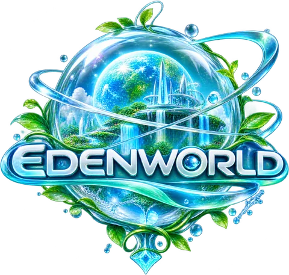
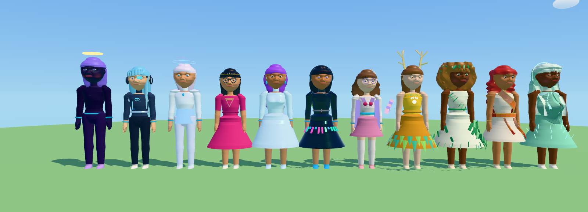

<p align="center">
  
</p>

# EDENWORLD — Genesis 0.5 · “O universo ganha corpo”

**A World Beyond Imagination.** Um mundo aberto em 3D do universo Éden Aero que roda direto no navegador — no computador, no celular e no tablet, sem instalar nada.

Não é mais uma cidade: são **sete regiões permanentes** do Éden, duas delas construídas e caminháveis. **Aurora City**, a cidade-jardim à beira-mar, e **Rosas Park**, ligadas pela Estação do Éden — com interiores em que se entra de verdade, moradores com rotina, economia em Cristais, casa própria, bichos e as onze figuras do panteão em seus lugares. E as pessoas deixaram de ser primitivas: têm corpo modelado, rosto com órbita e pálpebra, e dez das onze divindades vestem peças desenhadas só para elas.

<p align="center">
  
</p>

<p align="center"><sub>O panteão do Éden na bancada de personagens, no nível Ultra: Aérion, Haru, Nexara, Suki‑Chan, Luma, Lilly, Akemi‑Chan, Saturno, Maze, Júpiter e Amara.</sub></p>

## O que há nesta versão

- **Aurora City**, com 11 áreas: Praça Central (e a Esfera Aurora), Centro de Aurora, Distrito Cristal, Vila das Nuvens, Parque das Águas, Ilha do Gazebo, Jardins Suspensos, Mirante Celeste, Palco Aurora, Orla Cristalina e Píer da Orla.
- **Criador de avatar**: nome, tom de pele, cabelo, olhos, roupa, cores, acessório e altura. O visual pode ser trocado depois no Ateliê Aero ou pelo EdenPhone.
- **Exploração em terceira pessoa**: andar, correr, pular, nadar, sentar e acenar, com câmera que desvia de obstáculos.
- **Rosto e gestos**: o avatar tem sobrancelhas, pálpebras e boca de verdade, com **sete expressões**, piscada automática e boca que acompanha a fala. São **13 gestos** (acenar, cumprimentar, falar, concordar, negar, pensar, apontar, rir, surpresa, despedir, aplaudir, espreguiçar e a mão no ventre, de Amara) e todos funcionam **enquanto você anda**: o gesto é de tronco para cima e as pernas continuam no passo.
- **128 pontos de interação**: a Esfera Aurora, fontes, bancos, placas, holomapa, painel de eventos, telescópios, portais e o ateliê.
- **Coisas para encontrar**: 24 Cristais de Luz, 31 anotações no diário e 8 portais que, depois de ativados, permitem viagem rápida.
- **Habitantes de Aurora City**: 54 moradores simulados ao mesmo tempo (até 18 visíveis, conforme a qualidade), cada um com nome, ocupação, roupa, velocidade e rotina que muda de madrugada, manhã, tarde e noite. Dá para conversar com qualquer um.
- **A cidade repara em você.** A nove metros o morador vira a cabeça e acompanha; a cinco e meio ele cumprimenta — no máximo uma vez a cada 26 segundos por pessoa, e nunca de madrugada, quando a cidade está quieta. Dois moradores que se cruzam param, se viram um para o outro e conversam por alguns segundos, com gesto e expressão. Aperte `G` numa praça cheia e quem estiver por perto **responde ao aceno**, cada um no seu tempo — não em bloco.
- **Cada pessoa tem um jeito.** Os gestos preferidos, o humor da saudação e a frequência com que se mexe vêm de uma *persona*: Suki‑Chan gesticula sem parar, Saturno quase não se move, Haru demora mais para começar.
- **Corpos de verdade, não primitivas.** O avatar deixou de ser um boneco de esferas e cilindros: é uma malha única, com volume contínuo, ombro que não quebra na junta, articulações que dobram, oclusão assada por vértice e materiais PBR. O rosto tem órbita, pálpebra, nariz e lábios com geometria — não desenho sobre uma bola. Cada corpo é montado em **quatro níveis** (Baixa, Média, Alta e Ultra), e o nível é escolhido pela qualidade gráfica e pela distância. Ver [`docs/CHARACTER-REMASTER.md`](docs/CHARACTER-REMASTER.md) e [`docs/VALIDACAO-CHARACTER-2.0.md`](docs/VALIDACAO-CHARACTER-2.0.md).
- **O panteão remasterizado, um a um.** **Dez das onze** figuras ganharam penteado, traje e acessório **desenhados só para elas**, peça por peça, cada uma com seu documento de plano e de validação: o cabelo Cascata e as lentes vazadas da Suki‑Chan, o traje Rede da Nexara, a Sonora de Lilly com as teclas na saia, a fibra óptica da Akemi‑Chan, a Guardiã de Saturno com a galhada, o traje EdenOS e os abafadores de Haru, a Copa e o Jardim de Maze, o Lúmen de Júpiter e o Manto Regaço de Amara. Nenhuma dessas peças entra no sorteio dos habitantes: são exclusivas, e há teste que guarda isso. **Aérion é a exceção** — ela ainda veste peças do catálogo comum, e por isso serve de testemunha nas provas de não‑regressão.
- **O panteão em pessoa**: Aérion, Haru, Nexara, Suki‑Chan, Luma, Lilly, Akemi‑Chan, Saturno, Maze, Júpiter e Amara estão em pontos fixos da cidade, com aura, plaquinha de nome, diálogo em árvore, registro no diário e contato no EdenPhone. As falas da árvore de cada um trazem direção de atuação: o nó diz qual expressão e qual gesto acompanham aquela frase, então Suki comemora, Saturno pondera e Amara mede a distância.
- **Um universo, não uma cidade**: sete regiões permanentes — Aurora City, Bitnara, SkyStones, Rosas Park, Noureja Nether, Cidade da Liberdade e Jardim Proibido. Regiões **não são fases**: não há seleção de nível nem ordem obrigatória, e tudo atravessa a viagem (cristais, inventário, bichos, casa, atividades). Você descobre uma região conversando com quem cuida dela — e duas delas só aparecem para quem as achar. Aurora City e **Rosas Park** têm cenário 3D construído, com interiores que se entra de verdade e bichos selvagens desenhados; as outras já existem no mapa, nas lojas, na fauna e nas atividades, e a tela diz isso em vez de levar você para o vazio. Ver [`docs/PLANO-UNIVERSO-VIVO.md`](docs/PLANO-UNIVERSO-VIVO.md) e [`docs/PLANO-ROSAS-3D.md`](docs/PLANO-ROSAS-3D.md).
- **Interiores construídos**: entrar num prédio não abre um cômodo vazio. Apartamento, loja de tecnologia, mercado, pet shop e repartição pública têm piso, parede, teto, janela com vista, móvel, luz e gente — cada um com planta própria, escada que se sobe e colisão que acompanha a geometria. Ver [`docs/PLANO-INTERIORES.md`](docs/PLANO-INTERIORES.md).
- **Economia com consequência**: a moeda é o Cristal. Trinta itens em sete marcas (EdenTech, EdenGame, Afters Store, EdenPawl, EdenHome, EdenFashion, EdenMusic), treze lojas com horário real, devolução com prazo e extrato. Nenhum botão de compra é enfeite: o computador comprado na EdenTech vira um objeto que você instala em casa.
- **Casa própria**: quatro imóveis para comprar ou alugar, com grade de colisão de meio metro — o sofá não entra dentro da cama, e girar um móvel troca a largura pela profundidade de verdade.
- **EdenPawl**: oito espécies domésticas adotáveis, treze selvagens e cinco criaturas originais do Éden, num registro aberto. As necessidades caem devagar e mexem no humor, **nunca na saúde**: nenhum bicho morre, adoece ou é tirado de você por descuido. E animal selvagem não vira bicho de estimação — Saturno é clara quanto a isso.
- **Amara, Deusa da Maternidade**: o domínio dela é o cuidado com o que ainda está começando, e ela está grávida. A gestação é parte de quem ela é — aparece na silhueta do avatar em qualquer ângulo, de qualquer aparelho, e o gesto *mão no ventre* entra sozinho nas conversas dela. É um traço de personagem (`EdenCharacter.gestation`), **não** um canal Afters: não existe controle para aplicar gestação a ninguém. A matemática vive em [`src/player/Gestation.ts`](src/player/Gestation.ts), espelhada TS ↔ GLSL como a dos Afters, e a prova visual é `docs/amara-gestacao.png`.
- **A conversa acontece no mundo, não por cima dele.** A fala aparece numa barra no pé da tela, com a cidade visível e iluminada atrás; o texto é datilografado com as pausas da pontuação, dá para pular com um toque, há histórico das últimas falas e as escolhas só aparecem quando a pessoa termina de falar. Enquanto conversam, os dois ficam virados um para o outro e a cabeça acompanha.
- **Voz**: o jogo **não tem dublagem** e não finge ter. Em **Configurações → Áudio** existe a opção **Falas**: no padrão (*texto*) a boca do personagem se mexe no ritmo da datilografia; em *síntese* o jogo usa a voz sintética do próprio navegador, de graça e sem servidor, com tom e velocidade próprios de cada figura do panteão. Se um dia houver clipes gravados, eles entram no lugar sem mudar mais nada — a estrutura já está pronta e é entregue vazia.
- **Viagem entre regiões**: a **Estação do Éden** fica na Praça Central de Aurora City e ao lado do portão de Rosas Park — chegue perto e interaja para abrir a lista de destinos. Pelo telefone: EdenPhone → **Mapa do Éden** → *Viajar para Rosas Park*. Você leva tudo: cristais, inventário, bichos, casa, missões e diário.
- **EdenOS no EdenPhone**, com 14 aplicativos: mapa com viagem rápida, diário, jornada, câmera (foto em PNG), céu, **Pessoas**, **EdenTalk**, **EdenGram**, **EdenFeed**, **EdenReads**, **Afters**, **EdenMusic**, eventos e ajustes.
- **Afters 2.0 (Body Expansion Tech)**: seis produtos do cânone — AfterBust®, AfterCurve®, GelGrow®, CandyGrow®, AfterLove e AfterVelvet — liberados por Luma no Ateliê Aero.
  - **AfterBust®** e **AfterCurve®** são os dois produtos que **transformam o avatar**: silhueta superior e silhueta inferior, de **0% a 250%**, cada um com interruptor, slider, leitura numérica e botão **Reiniciar** próprios. Podem ser usados separados ou **combinados**, ligados e desligados de forma independente, e ajustados **enquanto você anda, corre ou conversa** — sem recarregar a cena, sem teleporte e sem trocar de avatar. A duração da transição é um controle à parte da intensidade. Em 0% a silhueta original volta exatamente como era.
  - Os outros quatro produtos (GelGrow®, CandyGrow®, AfterLove, AfterVelvet) são **efeitos complementares** — anel de presença, halo e partículas em volta do corpo. Ficam numa seção à parte, com cor, intensidade, som e desligamento manual: nunca substituem a transformação. A luz de assinatura do AfterBust® e do AfterCurve® fica dentro da seção de cada um.
  - Desligar guarda a porcentagem escolhida; **Reiniciar** volta ao padrão de 0%. Intensidades, ativações, duração e preset são gravados no salvamento.
  - **A cidade também usa.** Os moradores de Aurora City e as figuras do panteão passam pela mesma tecnologia, pelo mesmo sistema: cada um com a própria configuração de 0% a 250%, nos dois canais, separados ou combinados, estável enquanto a pessoa anda, corre ou está parada. Quem usa e quanto depende do perfil — a artista arrisca mais, o cuidador quase não usa —, e a escolha é sorteada da semente do habitante, então a cidade é a mesma em toda sessão. À noite quem tem esse gosto reforça um pouco; no **Palco Aurora** a cidade inteira sobe o tom. Um roteiro pode ligar, desligar ou trocar o preset de uma pessoa específica, e essa mudança é gravada no salvamento.
- **Dia e noite** (um dia dura 24 minutos reais) e clima variável: céu limpo, brisa e neblina.
- **Um jogo só, em qualquer aparelho.** Não existe versão mobile: a mesma Aurora City, os mesmos moradores e o mesmo progresso rodam no computador, no Android e no iPhone/iPad. O jogo reconhece o aparelho sozinho — inclusive o iPad, que se apresenta como Mac, e o tablet Android, que omite a palavra *Mobile* — e escolhe o comando adequado. Em **Configurações → Teclado e toque** dá para fixar o esquema à mão (automático, teclado e mouse, tela de toque ou controle): serve para o tablet com teclado acoplado e para o notebook de tela sensível.
- **Três formas de jogar**, com troca automática entre elas: teclado e mouse, tela de toque e controle. Teclas e botões podem ser remapeados.
- **Deitado ou em pé.** A tela de toque funciona nas duas orientações: deitado se vê mais cidade (e o jogo sugere isso uma vez, sem obrigar), em pé a interface se reorganiza — analógico mais alto, botões menores, EdenPhone ocupando a largura.
- **Configurações** de gráficos (**quatro** níveis de qualidade — Baixa, Média, Alta e Ultra —, meta de **30 ou 60 FPS**, sombras, reflexos, escala de resolução, resolução dinâmica), áudio (incluindo volume de **voz** e o modo das **falas**), controles e jogo. Cada nível mexe em resolução, sombra, distância de visão, densidade de partículas, efeitos de ambiente e também na **frequência de simulação dos moradores** — a parte que mais pesa num celular.
- **Salvamento automático** no próprio navegador, com opções de continuar, novo jogo, exportar, importar e apagar.
- **Interface em português do Brasil**, navegável por mouse, toque, teclado e controle.

Os recursos que ainda dependem de servidor, loja ou catálogo licenciado (Éden Connect, EdenStore, EdenTV, EdenGame, EdenPawl e os eventos com data) continuam aparecendo apenas como **“em breve”**: nenhum deles simula algo que não existe. Os aplicativos sociais que **existem** dizem, dentro da própria tela, que tudo fica guardado só naquele aparelho — não há conta, servidor nem outras pessoas on‑line.

## Como jogar

### Teclado e mouse

| Ação | Comando |
| --- | --- |
| Andar | `W` `A` `S` `D` ou setas |
| Correr | `Shift` |
| Pular | `Espaço` |
| Interagir | `E` ou `Enter` |
| EdenPhone | `Tab` ou `P` |
| Acenar | `G` |
| Centralizar a câmera | `C` |
| Pausar / menu | `Esc` |
| Girar a câmera | mover o mouse (clique no jogo para capturar o cursor) ou arrastar |
| Zoom | roda do mouse |

### Tela de toque

| Ação | Comando |
| --- | --- |
| Andar | analógico virtual no lado esquerdo da tela |
| Girar a câmera | arrastar o dedo no restante da tela |
| Zoom | movimento de pinça |
| Pular, correr e interagir | botões no canto inferior direito |
| EdenPhone e pausa | botões dedicados acima dos de ação, à direita |
| Orientação | funciona deitado e em pé; deitado se vê mais cidade |

Durante o jogo, a pinça e o menu de toque longo do navegador ficam
bloqueados sobre a cena 3D — mas rolar com um dedo nas listas, no feed e nas
configurações continua funcionando normalmente, e fora do jogo o navegador
volta ao comportamento de sempre.

### Controle (padrão Xbox / PlayStation)

| Ação | Comando |
| --- | --- |
| Andar | analógico esquerdo |
| Girar a câmera | analógico direito |
| Pular | `A` / Cruz |
| Correr | `RT` / `R2` |
| Interagir | `X` / Quadrado |
| EdenPhone | `Y` / Triângulo |
| Acenar | direcional para cima |
| Centralizar a câmera | `R3` |
| Zoom | `LB` e `RB` |
| Pausar / menu | `Start` / `Options` |

Nos menus: direcional ou analógico esquerdo para navegar, `A` confirma, `B` volta, `LB`/`RB` trocam de aba.

As teclas e os botões de ação podem ser trocados em **Configurações**.

## Requisitos

- Para jogar: um navegador atual com **WebGL2** (Chrome, Edge, Firefox ou Safari recentes). Sem WebGL2, o jogo mostra uma tela de aviso em vez de abrir.
- Para desenvolver: **Node.js 22.12** ou mais novo (de preferência uma versão LTS) e npm.

## Rodando o projeto

```bash
npm install      # instala as dependências
npm run dev      # servidor de desenvolvimento em http://localhost:5173
```

Outros comandos:

| Comando | O que faz |
| --- | --- |
| `npm run build` | Confere os tipos e gera a versão de produção na pasta `dist/` |
| `npm run preview` | Serve a pasta `dist/` em http://localhost:4173 para conferência |
| `npm run typecheck` | Só a checagem de tipos do TypeScript |
| `npm test` | Testes unitários (Vitest) |
| `npm run test:e2e` | Gera o build e roda os testes de ponta a ponta em um Chromium sem interface |

Para abrir o servidor de desenvolvimento por um túnel ou outro domínio, informe os hosts permitidos:

```bash
EDENWORLD_ALLOWED_HOSTS=".meu-tunel.dev" npm run dev
```

## Publicação

O jogo é um **site estático**: `npm run build` gera a pasta `dist/` (cerca de 2,2 MB; aproximadamente 400 kB compactados com gzip — 254 kB do jogo e 146 kB do Three.js, em arquivos separados para o navegador guardar o Three.js entre versões) e basta hospedar o conteúdo dela. Não há servidor, banco de dados nem variáveis de ambiente.

- Os caminhos são relativos (`base: './'` no `vite.config.ts`), então o jogo funciona tanto na raiz de um domínio quanto em uma subpasta, como `https://usuario.github.io/EdenWorld/`.
- Sirva por **HTTPS**: alguns navegadores só liberam o uso do controle em páginas seguras.
- Qualquer hospedagem de arquivos estáticos serve: GitHub Pages, Netlify, Vercel, Cloudflare Pages, itch.io (envie o conteúdo de `dist/` em um arquivo `.zip`) ou um servidor próprio.

### Exemplo: GitHub Pages

No plano gratuito do GitHub, o Pages só está disponível para repositórios públicos. Para publicar automaticamente a cada atualização do ramo `main`, ative **Settings → Pages → Source: GitHub Actions** e crie o arquivo `.github/workflows/publicar.yml`:

```yaml
name: Publicar no GitHub Pages

on:
  push:
    branches: [main]
  workflow_dispatch:

permissions:
  contents: read
  pages: write
  id-token: write

concurrency:
  group: pages
  cancel-in-progress: true

jobs:
  build:
    runs-on: ubuntu-latest
    steps:
      - uses: actions/checkout@v7
      - uses: actions/setup-node@v7
        with:
          node-version: 22
          cache: npm
      - run: npm ci
      - run: npm test
      - run: npm run build
      - uses: actions/upload-pages-artifact@v5
        with:
          path: dist

  deploy:
    needs: build
    runs-on: ubuntu-latest
    environment:
      name: github-pages
      url: ${{ steps.deployment.outputs.page_url }}
    steps:
      - id: deployment
        uses: actions/deploy-pages@v5
```

Este arquivo não faz parte do repositório: a escolha da hospedagem fica com quem publica.

## Testes

```bash
npm run typecheck   # tipos
npm test            # 1.394 testes unitários (lógica pura, sistemas, geometria e telas do EdenOS)
npm run test:e2e    # cinco cenários de ponta a ponta sobre o build de produção
```

Os **testes unitários** (`tests/unit/`) são **1.394 casos em 68 arquivos**, e cobrem três camadas.

**A lógica do jogo:** matemática, colisão, movimento do personagem, relógio do mundo, aparência do avatar, configuração de controles, níveis de qualidade, interações, economia, moradia, missões e salvamento — incluindo a migração do formato 1 para o 3, com salvamentos antigos que continuam abrindo. Mais a rede de caminhada e a rotina dos habitantes, a coerência do panteão e das árvores de diálogo, o acervo do EdenReads, o estado social do aparelho, a integridade dos portais e a persistência entre regiões, e o isolamento de iluminação quando se troca de região.

**A geometria dos personagens**, que é a camada mais recente e a maior: cada remasterização do panteão tem a sua bateria — a silhueta vista de cada ângulo, o acabamento de cada peça, o orçamento de triângulos nos quatro níveis, a fronteira de cor entre uma deusa e outra, e a garantia de que peça de deusa **não vaza para o catálogo dos habitantes**. A prova de não‑regressão é por **assinatura de malha**: `tools/assinaturas.ts` reduz cada corpo a um número, e comparar o antes e o depois mostra exatamente quem mudou. Em um marco de personagem, só a personagem daquele marco pode divergir.

**As telas**, em um DOM de teste (`happy-dom`): cada botão precisa chamar o jogo de verdade, nenhum é enfeite. A datilografia e suas pausas, a barra de fala, a regência da conversa, a direção de atuação das árvores do panteão, os 13 gestos — com a garantia de que **nenhum deles toca nas pernas**, para continuarem funcionando enquanto o personagem anda —, as regras de notar e cumprimentar, os três degraus do sistema de voz (clipe, síntese do navegador, texto) e a verificação de que, sem clipes e sem síntese, o jogo **não promete dublagem**. E `tests/unit/versao.test.ts`, que monta o menu principal e confere que o número de versão exibido é o desta build.

Os **testes de ponta a ponta** (`tests/e2e/`) abrem o jogo em um Chromium sem interface e o usam como um jogador:

| Cenário | O que percorre |
| --- | --- |
| `desktop` | Menu, criador, movimento, interações, EdenPhone, modo foto e configurações com teclado e mouse |
| `persistencia` | Salvar, recarregar, continuar, novo jogo, exportar, apagar e importar |
| `celular` | Tela de toque em retrato (390×844) e paisagem (844×390) |
| `controle` | Jogo e menus só com o controle, incluindo conectar e desconectar |
| `robustez` | Navegador sem WebGL2, armazenamento bloqueado, salvamento corrompido ou adulterado, perda do contexto gráfico e limite do mapa |

> **Atenção:** os cenários de ponta a ponta **não foram executados** na máquina em que a Genesis 0.5 foi fechada. A suíte unitária e o build de produção foram; o e2e exige um Chrome completo. Rode-os localmente antes de publicar.

```bash
node tests/e2e/run.mjs celular controle                   # só alguns cenários (exige "npm run build" antes)
EDEN_URL=http://localhost:5173/ node tests/e2e/run.mjs    # testa um servidor que já está no ar
```

O executor procura um Chrome, Chromium ou Edge instalado. Se não encontrar, informe o caminho em `EDEN_CHROME`. As capturas de tela vão para `tests/e2e/artifacts/` (fora do Git; mude com `EDEN_ARTIFACTS`). Em máquinas sem placa de vídeo a renderização é feita por software e a suíte completa leva de 10 a 15 minutos.

## Estrutura

```text
index.html               página única do jogo
lab.html                 bancada de personagens: a oficina onde a geometria é olhada
public/                  logotipo, ícones e manifesto do aplicativo web
design/brand/            logotipo original e a origem dos arquivos derivados
src/
  main.ts                ponto de entrada: checa o WebGL2 e inicia o Engine
  core/                  Engine (orquestra tudo), laço do jogo, renderizador, configuração e versão, detecção de plataforma
  world/                 terreno, céu, água, luz, clima, relógio, vegetação, partículas
  regions/               as sete regiões do Éden, viagem entre elas e o que atravessa
  universe/              estado do universo que sobrevive à viagem
  cities/aurora-city/    planta, prédios, praça, parques e decoração de Aurora City
  cities/rosas-park/     a segunda região construída
  interiors/             plantas, móveis, escadas e colisão dos ambientes em que se entra
  npc/                   rede de caminhada, rotina, vida social e desenho dos moradores
  characters/            panteão do Éden (dados, lugares, árvores de diálogo e personas)
  creatures/             espécies, corpo e movimento dos bichos
  economy/               Cristais, lojas com horário, catálogo, devolução e extrato
  housing/               imóveis, aluguel e a grade de colisão dos móveis
  missions/              cadeias de tarefa e seu progresso
  edenos/                acervo do EdenReads e estado social do aparelho
  afters/                catálogo, transformação de silhueta e efeitos em volta do avatar
  physics/               colisão e consultas ao cenário (sem biblioteca externa)
  player/                avatar, animação, gestos, rosto e movimento
  player/body/           a malha do corpo: perfis, costura, acabamento e os quatro níveis
  camera/                câmera em terceira pessoa
  input/                 teclado e mouse, toque, controle, remapeamento e guarda de gestos do navegador
  interactions/          pontos de interação e colecionáveis
  systems/               qualidade gráfica, medição de desempenho, salvamento, progresso, áudio e voz
  interface/             HUD, menus, criador de avatar, EdenPhone e configurações
  lab/                   a cena da bancada (não entra no build do jogo)
  styles/                folha de estilo da interface
  utils/                 matemática e geometria de apoio
  shared/                catálogo dos recursos “em breve”
  eden-connect/, social/ pontos de extensão para os futuros recursos on-line
tests/
  unit/                  testes unitários (Vitest)
  e2e/                   testes de ponta a ponta (puppeteer-core)
tools/                   instrumentos de inspeção: captura em WebGL, assinaturas de malha, leitura de pixels
docs/                    planos e validações de cada marco, com as imagens que decidiram
```

Feito com **TypeScript**, **Three.js** (WebGL2) e **Vite**. Não há motor de jogo, biblioteca de física nem framework de interface.

### Conteúdo gerado por código

Modelos, texturas, céu, água, vegetação, sons e música são gerados em tempo de execução. O único arquivo de imagem do jogo é o logotipo (`public/assets/ui/`) e os ícones derivados dele. Por isso o download é pequeno e não há dependência de arquivos de terceiros.

### Dados e privacidade

- O progresso e as preferências ficam apenas no `localStorage` do navegador, na chave `edenworld.save.v1` (formato na versão 2; salvamentos da versão 1 continuam sendo aceitos).
- As fotos do EdenGram, os contatos, as conversas lidas e os ajustes de Afters são gravados nesse mesmo salvamento, no próprio aparelho. O EdenGram guarda no máximo 12 fotos, em miniatura, para não estourar o armazenamento do navegador.
- O jogo não faz nenhuma requisição de rede depois de carregado: não há conta, anúncios, telemetria nem fontes externas.
- Limpar os dados do navegador apaga o progresso. Em **Configurações → Jogo** é possível exportar o salvamento para um arquivo e importá-lo depois, inclusive em outro navegador ou aparelho. A importação traz o avatar e o progresso; as configurações de cada aparelho são mantidas.

### Parâmetros de URL para desenvolvimento

| Parâmetro | Efeito |
| --- | --- |
| `?quality=baixa`, `media`, `alta` ou `ultra` | Força um nível de qualidade gráfica |
| `?bench` ou `?bench=45` | Mede o desempenho real do aparelho (padrão: 20 s) e imprime média, mediana, **1% pior** e quadros dentro da meta |
| `?noaudio` | Inicia sem áudio |
| `?skipmenu` | Pula o menu e entra direto no jogo |
| `?debug` | Expõe `window.__eden` (estado e atalhos usados pelos testes) e aceita `x`, `z`, `heading`, `yaw`, `pitch`, `dist` e `h` para posicionar o jogador, a câmera e a hora |

Com `?debug`, para desempenho e aparelho: `__eden.plataforma()` mostra o que foi detectado (sistema, formato, esquema e orientação), `__eden.medir(30)` roda uma medição de 30 segundos e `__eden.desempenho()` devolve o último relatório. Além do que já existia: `__eden.npcs()` lista a população e onde está cada figura do panteão, `__eden.irPara('haru')` leva você até ela, `__eden.bandeiras()` mostra as marcas de história e `__eden.afters()` mostra o estado do painel Afters, incluindo `body` (intensidades e ativações) e `silhueta` (o que o avatar mostra neste instante, com a transição em andamento). Para a cidade: `__eden.aftersCidade()` resume quantos habitantes usam a tecnologia e qual evento está em vigor, `__eden.aftersNpc('cidadao:41', { bust: 150 })` muda uma pessoa, `__eden.aftersNpcPreset('cidadao:41', 'aurora')` aplica um preset e `__eden.aftersEvento('palco')` força um evento de cidade.

## Versões

| Versão | Data | O que marcou |
| --- | --- | --- |
| **Genesis 0.5** · *O universo ganha corpo* | 22/11/2026 | Sete regiões com duas construídas e viagem entre elas, interiores, economia em Cristais, casa, bichos, corpos modelados e o panteão remasterizado |
| **Genesis 0.2** · *A cidade ganha gente* | 12/11/2026 | Habitantes com rotina, o panteão em pessoa, diálogo em árvore, EdenOS funcional e os Afters |
| **Genesis 0.1** | 12/11/2026 | Aurora City jogável no navegador: terreno, cidade, avatar, câmera, interações e salvamento |

O número aparece no rodapé do menu principal e na tela **Sobre**. Ele é declarado em **um lugar só** — `GAME`, em [`src/core/Config.ts`](src/core/Config.ts) —, de onde a interface lê direto e o `index.html` recebe por injeção no build; `package.json` espelha o número, e [`tests/unit/versao.test.ts`](tests/unit/versao.test.ts) quebra se os dois divergirem. Essa trava existe porque a deriva já aconteceu: a Genesis 0.2 subiu só o título deste arquivo, e por 33 pull requests o jogo continuou dizendo "Genesis 0.1" para quem abria o menu.

O caminho até a **EDENWORLD 1.0** está em [`docs/PLANO-EDENWORLD-1.0.md`](docs/PLANO-EDENWORLD-1.0.md), e o que entrou nesta versão, com os números, em [`docs/RELEASE-GENESIS-0.5.md`](docs/RELEASE-GENESIS-0.5.md).

## Limites conhecidos

- **O desempenho em celular não foi medido.** As metas do projeto são 30 FPS estáveis em celular intermediário e a opção de 60 FPS em hardware capaz — são **metas**, não resultados verificados: não há aparelho móvel nem GPU no ambiente em que o jogo foi desenvolvido. Para produzir o número no seu aparelho, abra o jogo com `?bench` (veja os parâmetros de URL acima). O áudio também nunca foi ouvido por uma pessoa.
- **Um jogador por vez.** Não há multijogador, contas nem serviços on-line nesta versão. O formato de troca da silhueta — do jogador e dos habitantes — já existe e é testado (`src/afters/AftersNet.ts`), mas nada é enviado: não há servidor para receber.
- **O salvamento é local.** Para continuar em outro navegador ou aparelho é preciso exportar o arquivo de salvamento e importá-lo manualmente.
- **O panteão está remasterizado em dez de onze.** Suki‑Chan, Nexara, Luma, Lilly, Akemi‑Chan, Saturno, Haru, Maze, Júpiter e Amara têm penteado, traje e acessório próprios. **Aérion ainda veste peças do catálogo comum** — o cabelo `longo`, o traje `aero` e a auréola que qualquer habitante pode usar. Ela não foi esquecida: é justamente por vestir peça genérica que serve de testemunha nas provas de não‑regressão, e o remaster dela é um marco à parte.
- **Duas regiões construídas, cinco por construir.** Aurora City e Rosas Park têm cenário 3D, interiores visitáveis, fauna desenhada e viagem funcionando entre elas (**Estação do Éden**, ou EdenPhone → Mapa do Éden). Bitnara, SkyStones, Cidade da Liberdade, Noureja Nether e o Jardim Proibido são destinos reais no mapa, nas lojas e nas atividades, mas ainda sem cenário — a tela diz isso em vez de levar você para o vazio.
- **Não há dublagem.** Nenhuma fala do jogo foi gravada por uma pessoa. O modo padrão é texto, com a boca acompanhando a datilografia; a síntese do navegador é opcional e depende de o navegador oferecê‑la (a tela de ajustes avisa quando não oferece). O lugar dos clipes existe no código e é entregue vazio.
- **O rosto é estilizado.** São sete expressões desenhadas, não um sistema de músculos faciais: a boca abre e fecha no ritmo da fala, sem visema por fonema.
- **A conversa entre dois moradores é mímica.** Eles param, se viram e gesticulam; não há texto trocado entre eles, e nenhuma tela sugere que haja.
- **As conversas não têm resposta por mensagem.** O EdenTalk mostra o que cada figura do panteão já disse e diz, na própria tela, que responder depende do Éden Connect; para conversar de verdade é preciso procurar a pessoa na cidade.
- **Afters muda a silhueta, não a anatomia.** O avatar é estilizado, feito de primitivas, e continua assim — para o jogador e para os habitantes: AfterBust® e AfterCurve® mudam o **volume suave** de uma região (com a roupa acompanhando), nunca detalhe anatômico. Não há câmera voltada para o corpo, o painel sempre mostra a porcentagem exata e o desligamento manual — inclusive "Desligar tudo" — está sempre à mão.
- **A noite ainda não é a Era Vice Éden.** O EdenFeed já reconhece o período, mas a identidade visual própria da noite (néon, pôr do sol tropical) entra numa etapa seguinte.
- **Funciona só on-line.** Há manifesto de aplicativo web (ícone e tela cheia ao adicionar à tela inicial), mas não há modo off-line.
