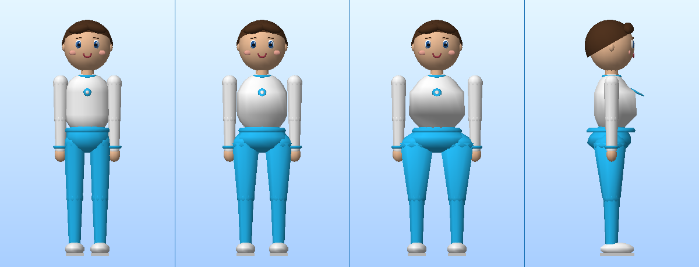

# Plano — AFTERS® 2.0 · transformação ao vivo da silhueta

Documento de implementação. Registra o que foi inspecionado, a decisão
técnica e o que cada arquivo faz.

## 1. O que já existia (inspeção, antes de tocar em qualquer arquivo)

| Peça | Situação encontrada |
| --- | --- |
| `src/player/Avatar.ts` | Avatar 100% procedural. 7 geometrias fundidas (`hips`, `torso`, `head`, `upperArm`, `forearm`, `thigh`, `shin`) em 11 malhas, hierarquia `root → scaler(altura) → pivot(quadril) → hips → {torso, pernas}`. **Um** `MeshStandardMaterial` com `onBeforeCompile` já injetando o uniforme `avatarFill`. Geometria reconstruída inteira em `setAppearance()`. |
| `src/player/AvatarAnimator.ts` | Pose procedural por canais (`Ch`), aplicada em `applyPose()` como rotações de juntas. |
| `src/afters/AftersCatalog.ts` | 6 produtos + `AftersConfig` (produto, cor, intensidade 0–1, partículas, som). |
| `src/afters/AftersSystem.ts` | Efeito **ao redor** do corpo: anel no chão, halo e ≤56 partículas. Não toca no avatar. |
| `src/interface/EdenApps.ts` | `buildAfters()`: lista de produtos, paleta, 1 slider de intensidade, 2 interruptores. |
| `src/systems/SaveSystem.ts` | v2 grava `afters` via `sanitizeAftersConfig()`. |
| `src/social/SocialSystem.ts` | `SocialService` + `RemotePlayerState` existem como contrato. `LocalSocial.online === false`: **não há rede**. |

Conclusão: os efeitos existentes são bons, mas são **acessórios**. Falta a
transformação da silhueta do próprio avatar.

## 2. Decisão técnica — por que deformar no shader

Três caminhos foram considerados para mudar a silhueta:

1. **Reconstruir a geometria** a cada mudança de intensidade.
   Descartado: `buildGeometries()` + `mergeGeometries()` custa milissegundos;
   numa transição suave de 0%→250% isso seria uma reconstrução por quadro.
   Travaria o jogo exatamente durante o efeito.
2. **Morph targets** (`BufferGeometry.morphAttributes`).
   Descartado: exigiria gerar e guardar uma segunda cópia de cada geometria
   por nível, multiplicando a memória, e o avatar é reconstruído a cada troca
   de roupa.
3. **Deformação no vertex shader** — escolhido.
   Custo por quadro: escrever dois `float` em uniformes. Funciona andando,
   correndo, nadando e sentado, porque a deformação acontece no espaço local
   de cada junta e o rig continua mandando na pose. A roupa acompanha o corpo
   porque está na mesma malha fundida.

### Como o shader sabe onde deformar

Cada geometria recebe um atributo por vértice `aZone`:

| Zona | Malha | Efeito |
| --- | --- | --- |
| 0 | cabeça, braços, antebraços, canelas | nenhum |
| 1 | tronco | AfterBust® |
| 2 | quadril (inclui a saia do vestido) | AfterCurve® |
| 3 | coxa | AfterCurve® atenuado, só no topo, para a junção não ficar estrangulada |

O deslocamento é radial no plano XZ, com peso gaussiano assimétrico em Y
(estreito para cima, largo para baixo) e viés de frente/trás. A normal é
corrigida na mesma passagem, senão a iluminação denunciaria a deformação.

A matemática fica em **um** lugar (`AftersMorph.ts`): as constantes alimentam
tanto a implementação de referência em TypeScript (testável, determinística)
quanto o GLSL gerado. Um teste compara as duas, para impedir que divirjam.

## 3. Arquivos

### Criados

| Arquivo | Responsabilidade |
| --- | --- |
| `src/afters/AftersMorph.ts` | Zonas, constantes, deslocamento de referência em TS e geração do GLSL |
| `src/afters/AftersState.ts` | Estado puro: intensidades 0–250%, ativação, duração, presets, validação |
| `src/afters/AftersChannel.ts` | `AfterBustController` e `AfterCurveController`: alvo, animação e estado atual |
| `src/afters/AftersBodySystem.ts` | `GameSystem` que anima os dois canais e escreve no avatar |
| `src/afters/AftersNet.ts` | Instantâneo serializável para multijogador futuro (sem rede hoje) |
| `src/interface/AftersApp.ts` | Aplicativo Afters do EdenPhone (vidro líquido, 2 sliders, presets, status) |

### Modificados

| Arquivo | Mudança |
| --- | --- |
| `src/player/Avatar.ts` | Atributo `aZone`, uniformes `uBust`/`uCurve`, injeção no shader, `setMorph()` |
| `src/afters/AftersCatalog.ts` | `AftersConfig.body` com as novas preferências |
| `src/interface/EdenApps.ts` | `buildAfters` passa a delegar ao novo aplicativo; contrato do host ampliado |
| `src/core/Engine.ts` | Registra o sistema, liga o avatar, trata os comandos do EdenPhone |
| `src/styles/main.css` | Painéis de vidro líquido, sliders grandes e leitura numérica |
| `src/social/SocialSystem.ts` | `RemotePlayerState.afters` opcional (contrato, sem implementação de rede) |
| `src/systems/SaveSystem.ts` | nada a mudar: `afters` já passa por `sanitizeAftersConfig()`, que agora valida `body` |
| `README.md` | descrição do Afters 2.0 e do que o `?debug` mostra |

## 4. Limites assumidos e declarados

- **Multijogador não existe.** `LocalSocial.online` é `false` e não há
  servidor. O que entra é o **contrato** (`AftersNetState`, serialização e
  interpolação), pronto para um serviço futuro. Nada é apresentado como
  sincronização funcionando.
- A transformação é de **silhueta estilizada**: o avatar é feito de primitivas
  (cápsulas e esferas) sem detalhe anatômico, e assim continua. O que muda é
  o volume suave da região, junto com a roupa.
- O desligamento manual continua sempre disponível, e 0% restaura exatamente
  a silhueta original.

## 5. Detalhes que apareceram na implementação

- **Sombra.** O mapa de sombras usa um material próprio (`MeshDepthMaterial`),
  que não passa pelo material do avatar. Sem tratamento, a sombra ficaria com
  a silhueta antiga enquanto o corpo muda. O avatar agora define um
  `customDepthMaterial` com a mesma deformação e os mesmos uniformes.
- **Escala de junta foi evitada de propósito.** Aumentar `torso.scale` levaria
  cabeça e braços junto (são filhos do tronco na hierarquia). Por isso a
  deformação é por vértice, com zona gravada no atributo `aZone`.
- **A coxa recebe uma banda atenuada** (`Zone.Thigh`): sem ela, o quadril
  crescer deixaria a junção quadril→perna estrangulada.
- **Ativação e intensidade são estados separados** no canal: desligar guarda a
  porcentagem escolhida, religar devolve exatamente o mesmo valor.
- **Transição reaproveitada.** Um novo alvo no meio da animação parte do valor
  atual, nunca do zero — por isso não há salto visível ao mexer no slider.

## 6. Prova visual sem navegador



Da esquerda para a direita: **0%** (silhueta original), **125%**, **250%** de
frente e **250%** de perfil. A imagem é gerada aplicando a conta do shader
(`AftersMorph`) à geometria real do avatar e rasterizando o resultado em
software — mesma matemática que roda na GPU, só que sem GPU:

```
EDEN_RENDER=1 npx vitest run tests/unit/afters-render.test.ts
```

Repare no perfil: o volume cresce **para a frente** no tronco e **para trás**
no quadril, não só para os lados — e os ombros e as pernas se afastam um
pouco, para nada atravessar o corpo. A faixa da cintura, a camiseta e o tênis
continuam inteiros.

## 6.1 Resultado

| Verificação | Resultado |
| --- | --- |
| `npm run typecheck` | limpo |
| `npm test` | 264 testes em 17 arquivos, todos passando (eram 202 antes); mais 1 teste pulado, o gerador de imagem |
| `npm run build` | sem erro |
| GLSL gerado | analisado por um parser de GLSL: sem erro de sintaxe |
| Navegador real | **não verificado**: não há Chrome/Chromium neste ambiente |

A verificação visual no navegador continua pendente por falta de navegador no
ambiente de desenvolvimento — não por falta de implementação. O servidor de
desenvolvimento sobe, e todos os módulos novos são transformados e servidos
sem erro.
