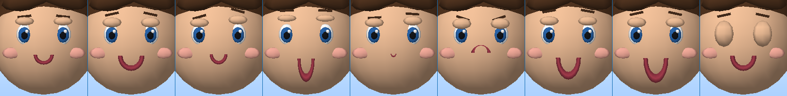
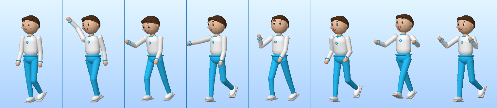

# Plano — Diálogo & Vida de NPC 2.0 · “a cidade olha de volta”

Documento de implementação. Registra o que foi inspecionado, a decisão
técnica e o que cada arquivo faz.

## 1. O que já existia (inspeção, antes de tocar em qualquer arquivo)

| Peça | Situação encontrada |
| --- | --- |
| `src/characters/Dialogue.ts` | Árvore de diálogo com `DialogueNode{id,text[],effects?,choices?}`, `DialogueRunner`, memória de flags e validador. Sólido — e **mudo**: o nó não dizia nada sobre como a fala devia ser dita. |
| `src/interface/DialogueScreen.ts` | Caixa de texto modal, com fundo escurecido, que mostrava **o parágrafo inteiro de uma vez**. Sem datilografia, sem histórico, sem retrato do falante. |
| `src/player/AvatarAnimator.ts` | Pose procedural por canais (`enum Ch`), com estados (parado, andar, correr, nadar, sentar) e **um** gesto embutido: o aceno, escrito à mão dentro do `update`. |
| `src/player/Avatar.ts` | Avatar procedural. Cabeça com olhos, pupilas, brilho e bochechas — **sem boca, sem sobrancelha, sem pálpebra**. O rosto era uma esfera lisa. |
| `src/npc/CitizenSim.ts` | Rotina por período do dia, caminho por pontos, `startTalking`/`stopTalking` que **giravam o morador instantaneamente**. |
| `src/npc/NpcSystem.ts` | 54 moradores simulados, até 18 avatares num pool reaproveitado, `waveCooldown` por slot. O aceno de volta existia; expressão e olhar, não. |
| `src/systems/AudioSystem.ts` | Web Audio procedural com barramentos `master`/`music`/`ambience`/`effects`. **Nenhum barramento de voz.** |
| `src/core/Engine.ts` | `startConversation()` abria a tela e devolvia o controle; ninguém ficava virado para ninguém, e a conversa não tinha duração. |

Conclusão: a cidade tinha **gente**, tinha **rotina** e tinha **texto**. O que
faltava era o que acontece entre duas pessoas no instante em que elas falam —
o rosto, o gesto, o olhar e o tempo da fala.

## 2. Decisão técnica

Quatro decisões sustentam tudo o que vem depois.

### 2.1 O rosto é uma malha separada, com morph targets

O avatar inteiro é deformado no shader (ver `PLANO-AFTERS-2.0.md`), mas o
rosto **não**: expressão não é volume, é desenho. Três caminhos:

1. **Trocar a textura do rosto.** Descartado: não há textura nenhuma no
   projeto — tudo é cor por vértice. Introduzir um atlas de rostos criaria o
   primeiro asset de imagem obrigatório do jogo.
2. **Mover as peças como objetos** (uma sobrancelha = um `Mesh` girado).
   Descartado: seriam 7 objetos a mais por avatar, ×19 avatares na cena, cada
   um com matriz própria — e a mistura entre duas expressões viraria
   interpolação de transformadas à mão.
3. **Uma malha só, com alvos de morph** — escolhido. Sobrancelhas, pálpebras
   e boca são fundidas em **uma** geometria (`buildFaceGeometry`) com **seis**
   alvos. Mudar de expressão é escrever seis `float` em
   `mesh.morphTargetInfluences`; a GPU faz a mistura. Duas expressões podem
   coexistir (`pensativa` é 60% `curiosa` + 30% `triste`) e a boca da fala
   soma por cima de qualquer uma delas, porque os pesos são independentes.

Ordem fixa dos alvos: `sorriso, triste, surpresa, curiosa, fala, piscada`.

A malha do rosto usa o **mesmo material** do avatar — e por isso precisa
declarar o atributo `aZone` (com valor 0, “não deformar”), senão o vertex
shader dos Afters não compila. É um detalhe invisível que derruba a tela
inteira se for esquecido.

### 2.2 Gesto é camada, não estado

O animador reescreve a pose do zero a cada quadro. Se um gesto fosse um
estado, acenar pararia de andar. Então gesto é **sobreposição aditiva**,
aplicada depois das misturas de locomoção, e **nenhum gesto escreve nos
canais das pernas** — é uma regra verificada por teste, não uma convenção.

A ordem de empilhamento em `AvatarAnimator.update`:

```
parado → locomoção → fala (×0.9 do nível) → gesto saindo → gesto atual → olhar
```

O gesto que está saindo continua numa pista paralela enquanto desaparece, e
por isso trocar de gesto no meio não dá solavanco.

### 2.3 Não existe dublagem — e o jogo não finge que existe

Isto é uma decisão de honestidade, igual à dos aplicativos “em breve”. Não há
arquivo de áudio de voz no projeto, e gravar onze personagens não é algo que
se resolva em código. O que entra é a **estrutura em três degraus**, que
escolhe sozinha o melhor disponível:

| Degrau | Quando vale | O que o jogador ouve |
| --- | --- | --- |
| Clipes gravados | se um dia existirem arquivos no banco | a voz de verdade |
| Síntese do navegador (`speechSynthesis`) | se o jogador ligar em Ajustes → Falas | voz sintética, grátis, sem servidor |
| Texto | sempre | nada — mas a boca se mexe no ritmo da datilografia |

O banco de clipes é entregue **vazio** (`EmptyVoiceBank`), e a tela de ajustes
diz isso com todas as letras. Em **todos** os três degraus o sistema produz um
`level` de 0 a 1, e é esse número — não o texto — que abre a boca do
personagem. Trocar o degrau não muda nada no resto do jogo.

### 2.4 A conversa é um estado do mundo, não uma tela por cima do mundo

A caixa antiga escurecia a cena e parava tudo. A nova é uma **barra no pé da
tela**: a cidade continua visível, iluminada e andando atrás dela. Em troca,
enquanto a conversa dura, o mundo precisa se comportar — e é o `Engine` que
garante isso, renovando um contrato de 8 segundos a cada quadro
(`CONVERSATION_HOLD`): os dois ficam virados um para o outro, o morador não
retoma a rotina, e a cabeça acompanha.

## 3. Arquivos

### Criados

| Arquivo | Responsabilidade |
| --- | --- |
| `src/player/Gestures.ts` | Os 12 gestos: canais, quadros-chave, duração e `GesturePlayback` |
| `src/player/Expressions.ts` | As 7 expressões e o peso de cada alvo de morph |
| `src/player/AvatarFace.ts` | Geometria do rosto com 6 alvos + `FaceController` puro (piscada, fala, mistura) |
| `src/characters/Personas.ts` | Jeito de cada pessoa: gestos preferidos, humor de saudação, energia |
| `src/characters/DialogueSequence.ts` | Relógio da datilografia: páginas, pausas de pontuação, revelar tudo |
| `src/npc/NpcLife.ts` | Vida social de um NPC (notar, olhar, cumprimentar, conversar) — puro, sem Three.js |
| `src/systems/VoiceSystem.ts` | Os três degraus de voz e o nível de boca |
| `src/interface/DialogueBox.ts` | A barra de fala: nome, texto datilografado, histórico, escolhas |

### Modificados

| Arquivo | Mudança |
| --- | --- |
| `src/player/AvatarAnimator.ts` | Camadas de gesto, fala e olhar sobre a pose; `playGesture`/`setTalking`/`lookAt` |
| `src/player/Avatar.ts` | Malha do rosto como filha da cabeça, `setExpression`/`setTalking`/`updateFace` |
| `src/player/Player.ts` | `gesture()`, `express()`, `lookAt()` e a atualização do rosto por quadro |
| `src/characters/Dialogue.ts` | `DialogueNode` ganhou `mood` e `gesture`: o nó passa a dirigir a cena |
| `src/characters/Pantheon.ts` | **54 nós** receberam direção de atuação (humor e, quando cabe, gesto) |
| `src/npc/CitizenSim.ts` | `life`, giro suave para o interlocutor, `faceTowards`/`keepTalking`/`idleHere` |
| `src/npc/CitizenData.ts` | `WAVE_BACK` e `citizenWaveBack()`: a resposta ao aceno, estável por pessoa |
| `src/npc/NpcSystem.ts` | Vida por morador, conversas entre NPCs, `greetBack()` para a praça inteira |
| `src/interface/DialogueScreen.ts` | Reescrita: rege barra, voz, gesto, expressão e olhar durante a conversa |
| `src/interface/SettingsScreen.ts` | Linhas **Voz** (volume) e **Falas** (modo), com o aviso de que não há dublagem |
| `src/systems/SaveSystem.ts` | `AudioSettings.voice` e `AudioSettings.voiceMode`, com validação |
| `src/core/Engine.ts` | Conversa como estado do mundo, `holdConversation()`, tecla de aceno social |
| `src/styles/main.css` | Bloco `.talkbar*` no lugar do antigo `.talk*`, sem escurecer a cena |
| `README.md` | O que a cidade faz agora e o que a voz é (e não é) |

## 4. As peças, uma a uma

### 4.1 Doze gestos

`acenar`, `cumprimentar`, `falar`, `concordar`, `negar`, `pensar`, `apontar`,
`rir`, `surpresa`, `despedir`, `aplaudir`, `espreguicar`.

Um por vez; o anterior sai por uma pista paralela. Todos são de tronco para
cima — o teste `npc-vida.test.ts` varre os quadros-chave e falha se algum
gesto tocar `LegLX`, `LegRX`, `LegLZ`, `LegRZ`, `ShinL` ou `ShinR`.

### 4.2 Sete expressões

| Expressão | Mistura |
| --- | --- |
| `neutra` | — |
| `feliz` | sorriso 100% |
| `curiosa` | curiosa 100% + sorriso 30% |
| `surpresa` | surpresa 100% |
| `pensativa` | curiosa 60% + triste 30% |
| `triste` | triste 100% |
| `animada` | sorriso 100% + surpresa 50% |

A piscada é automática, a cada 2,6–7,5 s, sorteada da semente do avatar — dois
moradores lado a lado nunca piscam em uníssono. A boca da fala é um sétimo
peso somado por cima, suavizado para não bater.

### 4.3 Persona: o jeito de cada um

```ts
{ rest, greetMood, greet[], talk[], idle[], farewell, energy, idleEvery }
```

Onze personas para o panteão e dez para os arquétipos de morador. `energy`
decide a frequência dos gestos espontâneos. Suki‑Chan vive em 0.95 e gesticula
sem parar; Saturno, em 0.40, quase não se mexe — e isso aparece no teste como
invariante de canon, não como gosto de quem implementou.

### 4.4 A vida social de um NPC (`NpcLife`)

Puro, sem Three.js, testável quadro a quadro:

| Distância | O que acontece |
| --- | --- |
| 9 m | nota o jogador e acompanha com a cabeça por 1,5 s |
| 5,5 m | cumprimenta — no máximo uma vez a cada 26 s, e **nunca de madrugada** |
| 2,6 m entre dois NPCs | os dois param, viram um para o outro e conversam 7 s |

Em conversa, toda a autonomia é suspensa. Invisível (fora dos 18 avatares
desenhados), o morador só conta tempo — a vida continua existindo no modelo e
custa quase nada.

### 4.5 O aceno é respondido

Antes, `G` só levantava o braço do jogador. Agora `G` também sorri e chama
`NpcSystem.greetBack(x, z, 12)`: todo mundo num raio de 12 metros que não
esteja conversando **responde**. E não responde junto: cada um usa o mesmo
tempo de recarga de 26 segundos, então a praça devolve o aceno aos poucos.

Na conversa com um morador há uma escolha **“Acenar”**, que leva a um segundo
nó com a resposta dele — sorteada por um hash estável do nome, de modo que a
mesma pessoa sempre responde a mesma coisa.

### 4.6 A datilografia

48 caracteres por segundo, com pausas de pontuação: 0,22 s depois de `.`, `!`
e `?`; 0,1 s na vírgula; 0,12 s em `;` e `:`; 0,3 s nas reticências. Nunca no
último caractere de uma página — a pausa ali seria só espera.

Clicar (ou `E`, ou `Enter`) revela a página inteira; clicar de novo vira a
página; na última, encerra. A área de texto inteira é **um botão** — no
celular não existe alvo pequeno para errar.

### 4.7 A barra

Nome, papel e cor do falante; histórico das últimas 12 falas atrás de um
botão de livro; um marcador piscando só quando ainda há página. A cor do
personagem entra como variável CSS (`--talk`) e tinge a borda superior.

As escolhas só aparecem quando o **nó inteiro** termina — não quando a página
termina. Essa distinção foi a origem de três testes quebrados até ser
entendida.

## 5. Limites assumidos e declarados

- **Não há dublagem.** O banco de clipes é entregue vazio; o padrão é texto. A
  síntese do navegador é opcional, desligada por padrão, e avisa quando o
  navegador não a oferece.
- **O rosto é estilizado.** São sete expressões desenhadas, não um sistema de
  unidades de ação facial. Não há língua, dente nem visema por fonema: a boca
  abre e fecha no ritmo da fala.
- **A conversa entre dois NPCs é mímica.** Eles param, se viram e gesticulam
  por 7 segundos; não existe texto trocado entre eles, e nenhuma tela sugere
  que exista.
- **Verificação em navegador continua impossível neste ambiente** (não há
  Chrome/Chromium instalável). A prova é renderizada em software, como no
  Afters 2.0.

## 6. Detalhes que apareceram na implementação

- **O rosto também é desenhado na sombra.** Como a malha compartilha o
  material do avatar, ela entra na passagem de profundidade. Foi marcada com
  `castShadow = false`: uma sobrancelha não deve projetar sombra no chão.
- **A pálpebra tinha que ficar na frente do olho inteiro.** A pupila está em
  z = 0.167; a pálpebra ficou em z = 0.172. Com ela atrás, a piscada
  atravessava o globo ocular e aparecia *dentro* do olho — defeito que só a
  prova visual revelou.
- **Avatares vêm de um pool reaproveitado.** Expressão e gesto não podem
  morar no avatar, ou o morador que entra em cena herda a cara do que saiu.
  O estado vive em `CitizenSim.life`, e `resetSlotFace(slot)` limpa a malha
  na entrada **e** na saída.
- **`makeCitizen` sorteia de um gerador semeado, em ordem fixa.** Qualquer
  sorteio novo tem que ser acrescentado **no fim**, ou a cidade inteira muda
  de nome. Os 54 habitantes continuam byte a byte idênticos aos de antes.
- **Gate errado quebra o jogo em silêncio.** `!box.revealing` é verdadeiro ao
  fim de *cada página*; as escolhas apareciam no meio do nó. O certo é
  `box.finished`.
- **O giro para o interlocutor é suavizado** (`dampAngle`). Antes, o morador
  virava num quadro — parecia um manequim num pivô.

## 7. Prova visual sem navegador

Sem navegador no ambiente, as duas provas abaixo são geradas em software:
a mesma conta que a GPU faria com os alvos de morph (`posição + Σ peso ×
(alvo − posição)`) e o mesmo `AvatarAnimator` que roda no jogo, rasterizados
por um rasterizador mínimo.

```
EDEN_RENDER=1 npx vitest run tests/unit/rosto-render.test.ts
```

### As sete expressões, a fala e a piscada



Da esquerda para a direita: **neutra**, **feliz**, **curiosa**, **surpresa**,
**pensativa**, **triste**, **animada**, depois a **boca aberta da fala** e a
**piscada**. Repare que as sobrancelhas sobem na surpresa, se franzem na
tristeza, e que a pálpebra fechada cobre o olho inteiro sem atravessá‑lo.

### Os gestos, por cima da caminhada



Todos os quadros são do personagem **andando** — e é esse o ponto. Da
esquerda para a direita: caminhada sem gesto, **acenar**, **cumprimentar**,
**apontar**, **pensar**, **rir**, **surpresa** e **aplaudir**. As pernas
continuam no passo em todos eles, porque o gesto é camada de tronco para
cima; o que muda é só o que está acima da cintura. A expressão do rosto
acompanha o gesto onde faz sentido (`pensar` com `pensativa`, `surpresa` com
`surpresa`).

## 8. Resultado

| Verificação | Resultado |
| --- | --- |
| `npm run typecheck` | limpo |
| `npm test` | 382 testes em 21 arquivos, todos passando (eram 309 antes); mais 4 pulados, os geradores de imagem |
| `npm run build` | sem erro |
| Prova visual | `docs/rosto-expressoes.png` e `docs/gestos.png`, gerados do código real |
| Navegador real | **não verificado**: não há Chrome/Chromium neste ambiente |

Testes novos desta entrega:

| Arquivo | Cobre |
| --- | --- |
| `tests/unit/dialogo.test.ts` | Datilografia, barra, escolhas, histórico, regência da tela, direção de atuação do panteão |
| `tests/unit/npc-vida.test.ts` | Gestos sem perna, morphs do rosto, regras de notar/cumprimentar/conversar, giro suave, `greetBack` |
| `tests/unit/voz.test.ts` | Os três degraus de voz, o perfil de cada personagem e a promessa de que não há dublagem |
| `tests/unit/rosto-render.test.ts` | Gerador das provas visuais (pulado no dia a dia) |
