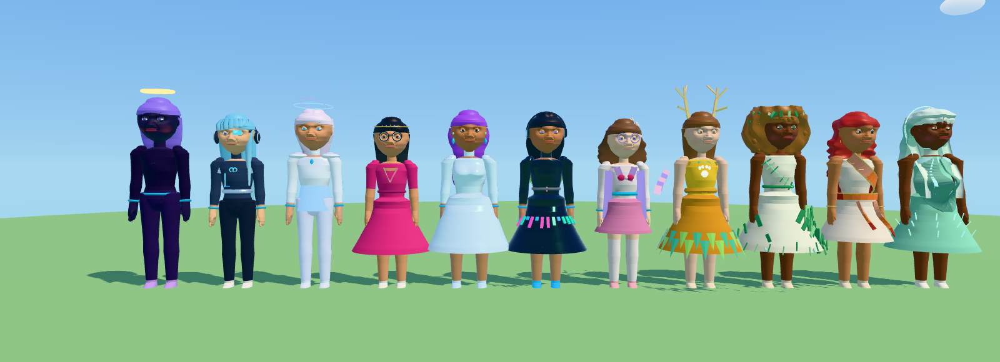

# EDENWORLD — Genesis 0.5 · “O universo ganha corpo”

**22 de novembro de 2026.** Terceira versão oficial do EDENWORLD, e a primeira
em dez dias — a Genesis 0.2 saiu em 12 de novembro e, de lá para cá, trinta e
três pull requests entraram na `main` sem que o número mudasse.

  

---

## 1. Por que 0.5, e não 0.3

A pergunta é legítima: o número anterior era 0.2, e o passo natural seria 0.3.

Só que 0.3 significaria **um** bloco temático desde a 0.2 — e o padrão que o
próprio projeto estabeleceu é claro, porque a Genesis 0.2 foi exatamente isso:
um pull request, o `#2`, que acrescentou o panteão, o EdenOS e os Afters de
uma vez. Esse é o tamanho de um passo menor aqui.

Desde então houve **seis** blocos desse porte:

| | Bloco | PRs |
| --- | --- | --- |
| 1 | Afters 2.0 ao vivo, diálogo e vida de NPC 2.0, controles universais | #3–#7 |
| 2 | Universo vivo: sete regiões, economia, moradia, bichos, atividades | #8, #9 |
| 3 | Rosas Park em 3D, Estação do Éden, interiores construídos | #9–#11 |
| 4 | Integridade do mundo: portais, persistência, iluminação por região | #12–#18 |
| 5 | Corpos orgânicos, EdenPhone lateral com prévia 3D, a saia que senta | #19–#23 |
| 6 | Panteão 2.0: dez deusas remasterizadas, uma a uma | #24–#35 |

E 0.5 também não é um número inflado, porque o que falta é grande. O roteiro
até a **EDENWORLD 1.0** está em [`PLANO-EDENWORLD-1.0.md`](PLANO-EDENWORLD-1.0.md),
em dez marcos. Auditados contra o código de hoje:

| Marco | Estado |
| --- | --- |
| A — Estabilização da Genesis | ✅ |
| B — Aurora City | ✅ |
| C — Identidade do jogador | ✅ |
| D — EdenPhone e EdenOS | ✅ |
| E — Afters (BET) | ✅ |
| F — Civilização viva | ✅ |
| **G — Outras cidades** | ⚠️ **2 de 7 construídas** |
| **H — Social e multijogador** | ❌ **não começou** — depende de servidor |
| **I — Moradia e eventos** | ⚠️ moradia, economia e missões prontas; eventos não |
| **J — Otimização e lançamento** | ⚠️ quatro níveis e LOD prontos; lançamento não |

Seis completos, três parciais, um bloqueado. Cinco cidades por construir e o
multijogador inteiro é, em trabalho, comparável a tudo o que já existe.
**0.5 é a metade do caminho, e é isso que o número diz.**

---

## 2. O que entrou

### O universo ganhou corpo

Deixou de ser uma cidade. São **sete regiões permanentes** — Aurora City,
Bitnara, SkyStones, Rosas Park, Noureja Nether, Cidade da Liberdade e Jardim
Proibido —, e **duas** têm cenário construído e caminhável, ligadas pela
Estação do Éden. As outras cinco existem no mapa, nas lojas, na fauna e nas
atividades, e a tela **diz que ainda não têm cenário** em vez de levar o
jogador para o vazio.

Regiões não são fases: não há seleção de nível nem ordem obrigatória, e tudo
atravessa a viagem — cristais, inventário, bichos, casa, missões e diário.

Junto vieram os sistemas que fazem um mundo e não um cenário: **interiores**
em que se entra de verdade, com planta própria, escada que se sobe e colisão
que acompanha a geometria; **economia** em Cristais, com trinta itens, treze
lojas com horário real e devolução com prazo, onde o computador comprado vira
um objeto que se instala em casa; **casa própria**, com grade de colisão de
meio metro; e **EdenPawl**, com bichos que têm corpo de bicho.

### As pessoas ganharam corpo

O avatar era um boneco de esferas e cilindros. Virou **malha única**, com
volume contínuo, ombro que não quebra na junta, articulações que dobram,
oclusão assada por vértice e materiais PBR. O rosto tem órbita, pálpebra,
nariz e lábios com geometria — não desenho sobre uma bola.

E o panteão foi remasterizado **um a um**, cada deusa com documento de plano
escrito antes da geometria e documento de validação escrito depois:

| Deusa | Penteado | Traje | Acessório |
| --- | --- | --- | --- |
| Luma | `ondulado` | **Aurora** | cristal |
| Suki‑Chan | **Cascata** | **Docente** | **lentes vazadas** |
| Nexara | **Fluxo** | **Rede** | — |
| Lilly | **Onda** | **Sonora** | — |
| Akemi‑Chan | **Cachos** | **Cosplay** | — |
| Saturno | **Silvestre** | **Guardiã** | — |
| Haru | **Fibra óptica** | **EdenOS** | — |
| Maze | **Copa** | **Jardim** | — |
| Júpiter | **Pincelada** | **Lúmen** | **ateliê** |
| Amara | **Nascente** | **Regaço** | **Nimbo** |

Nenhuma dessas peças entra no sorteio dos habitantes, e há teste que guarda
isso: `CITIZEN_HAIR_STYLES`, `CITIZEN_OUTFITS` e `CITIZEN_ACCESSORIES`
excluem cada uma nominalmente.

### Uma versão que se declara num lugar só

Esta parte não acrescenta nada ao jogo, e é a razão de a versão existir.

Até aqui o número morava em **seis lugares**, cada um editado à mão. A
Genesis 0.2 subiu só o título do README — e `Config.ts`, `package.json`,
`index.html` e o manifesto ficaram na 0.1. Como nada quebrava quando um deles
ficava para trás, ninguém percebeu por trinta e três pull requests, e durante
todo esse tempo **quem abria o menu principal via "Genesis 0.1"**.

Agora `GAME`, em [`../src/core/Config.ts`](../src/core/Config.ts), é a fonte:

- a interface lê direto;
- o `index.html` recebe por injeção, num plugin do `vite.config.ts`;
- o manifesto **não carrega mais número nenhum** — nome de aplicativo
  instalado não muda a cada versão, e um lugar a menos é um lugar que não
  pode divergir;
- o `package.json` espelha o número, porque precisa dele literal;
- [`../tests/unit/versao.test.ts`](../tests/unit/versao.test.ts) **monta o
  menu principal num DOM e lê o rodapé**, além de recusar qualquer `Genesis
  X.Y` escrito à mão em código, no HTML ou no manifesto.

A trava não confere que a string existe no código-fonte — isso provaria que
ela está escrita, não que o jogador a vê. Ela renderiza a tela.

---

## 3. Os números

| | Genesis 0.1 | Genesis 0.2 | **Genesis 0.5** |
| --- | --- | --- | --- |
| linhas de TypeScript | ~23 000 | — | **51 356** |
| arquivos de código | — | — | **150** |
| testes unitários | 96 | 202 | **1 394** |
| arquivos de teste | — | — | **68** |
| documentos técnicos | — | — | **40** |
| regiões jogáveis | 1 | 1 | **2** (de 7) |
| código do jogo (build) | — | 416 kB | **770 kB** |
| formato de salvamento | v1 | v2 | **v3** (abre v1) |
| panteão com peça própria | 0 | 0 | **10 de 11** |

Suíte completa no fechamento: **1 382 passando, 11 pulados e 1 falhando** em
68 arquivos, em 352 s. A única falha é a conhecida do Roseiral, descrita
adiante.

Build de produção: `dist/` com **2,2 MB**, sendo **254 kB** do jogo e **146 kB**
do Three.js em gzip, em arquivos separados para o navegador guardar o Three.js
entre versões.

---

## 4. O que esta versão **não** é

A regra de honestidade do projeto — nada é apresentado como pronto antes de
estar — vale também para a nota de versão.

- **O panteão está remasterizado em dez de onze.** **Aérion ainda veste peças
  do catálogo comum**: o cabelo `longo`, o traje `aero` e a auréola que
  qualquer habitante pode usar. Não foi esquecimento — é por vestir peça
  genérica que ela serve de testemunha nas provas de não‑regressão, e o
  remaster dela é um marco à parte.
- **Cinco regiões não têm cenário.** Existem como destino, loja, fauna e
  atividade; não como chão para pisar.
- **Não há multijogador, conta nem serviço on-line.** O formato de troca da
  silhueta existe e é testado em `src/afters/AftersNet.ts`, mas nada é
  enviado: não há servidor para receber.
- **Não há dublagem.** O padrão é texto, com a boca acompanhando a
  datilografia; a síntese do navegador é opcional.
- **Os eventos com data, a EdenStore, a EdenTV e o Éden Connect continuam
  "em breve".** Nenhum deles simula o que não existe.
- **O desempenho em celular não foi medido.** As metas são 30 FPS estáveis em
  aparelho intermediário e 60 FPS em hardware capaz, e são **metas**: não há
  aparelho móvel nem GPU no ambiente de desenvolvimento.
- **Os cenários de ponta a ponta não foram executados** no fechamento desta
  versão — exigem um Chrome completo. A suíte unitária e o build de produção
  foram.
- **Uma falha conhecida na suíte:** `tests/unit/coracao-roseiral.test.ts`
  estoura o orçamento de 5 s no teste de navegação do Roseiral. É anterior a
  esta versão — reproduzida na `main` em `f38a2ec` — e não toca em malha,
  ficha, catálogo nem acabamento.

---

## 5. A próxima

O bloco natural é **o marco G**, que é o maior que resta: dar cenário às
cinco regiões que só existem no mapa. Bitnara é a candidata, por já ter data
no cânone e praça, estúdio, arena, loja e café descritos.

Antes dela cabe um marco curto: **Aérion 2.0**, que fecha o panteão de
verdade. Quando isso acontecer, as provas de não‑regressão precisarão de uma
testemunha nova — um habitante genérico no lugar dela.
